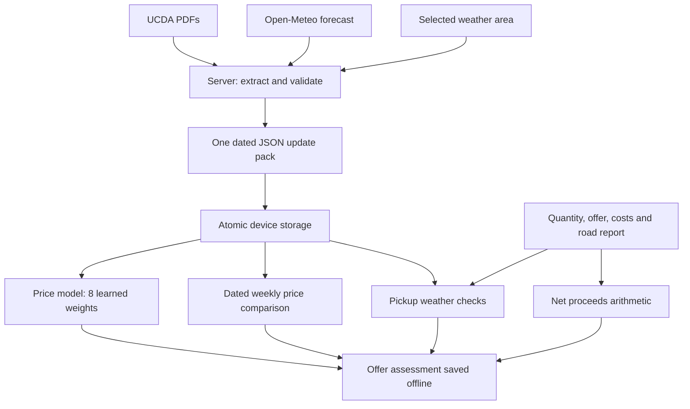

# Noor market workflow

Noor downloads a small dated data pack while online, then checks offers and pickup conditions locally. AI, reported prices, weather forecasts and entered costs retain separate provenance.

## Decisions

- **Small regression model:** 967 bytes, no extra inference runtime. Uses changes over 1, 3, 6 and 12 months, gaps from 6/12-month averages, and 6/12-month volatility. Standardization and strong ridge regularization constrain an eight-weight model fitted to a small historical sample. Twelve-month changes require 13 consecutive price observations. There is no substitute prediction when inputs or the model are unavailable.
- **Reported price and prediction remain distinct:** monthly model output is a forecast, not a live quote. Latest UCDA weekly range is used to describe a current offer's relation to published prices. Model evaluation has not beaten the last-price comparison. Do not call this architecture state of the art or guarantee accuracy.
- **Weather for pickup planning:** seven days of rain amounts/probabilities for the farmer-selected district. A forecast is not a price-model input. Rain alerts use explicit thresholds: probability at least 70% or daily precipitation at least 5 mm. These are planning rules, not learned effects on coffee prices or diagnoses of bean quality.
- **Costs stay inspectable:** net proceeds = quantity × buyer offer − entered transport quote − entered total fees. Blank costs remain unknown; they are not silently replaced with zero. Negative costs and non-finite values are rejected. A net total can be negative.
- **Road condition is farmer-reported:** unknown/clear/difficult/blocked; no fabricated traffic feed, ETA or route. Rain does not imply a blocked road. Road alerts ask the farmer to confirm access/quote.
- **Offline validity:** saved weather must cover the pickup date, must not describe a past pickup as current advice, and expires after seven days. Forecast source and download date remain attached to the saved assessment. A saved price pack is not live market knowledge.
- **One update transaction:** weekly records, monthly history, and a valid weather response are saved with a single IndexedDB transaction. Weather-provider failure may still permit the independently valid price update; cached weather retains its original date and is used only for its matching area/horizon. UCDA failure retains all previous data.
- **Small network transfer:** server extracts figures from PDFs; the phone does not download the PDF collection. Weather adds roughly 0.7 KB for seven records. Existing verified report packet is about 4.2 KB, plus weather and JSON metadata. Static app/model/WASM download is separate (~32 MB for leaf analysis).
- **Privacy and localisation:** selected district coordinates go to the weather service through the server. No GPS is required. Observations, offers and costs remain on the device. English/Luganda interface dictionary is cached offline; translation does not alter model inputs, user notes, quantities or currency.

## Model evidence

79 monthly records, January 2020–August 2026; 52 complete longer-history training examples. Retrospective final 15 months were previously inspected and are not an untouched test set. Fixed-weight MAE: 797 UGX/kg; rolling-refit MAE: 787; last-price comparison: 753. Historical error bands are descriptive, not calibrated confidence intervals. Publication delay assumes two months. Weather-price causal effects, lot grading, live traffic, and route optimization are not implemented.

## Reproducibility

Training data, selection code and evaluation: `training/price-v3/`. Server adapters: `lib/ucda.mjs`, `lib/weather.mjs`. Device inference: `public/price-core.js`. Weather validation, date gating and arithmetic: `public/market-core.js`. Device pack persistence: `public/reports.js`. UI planning and saved assessment provenance: `public/market-planning.js`.
